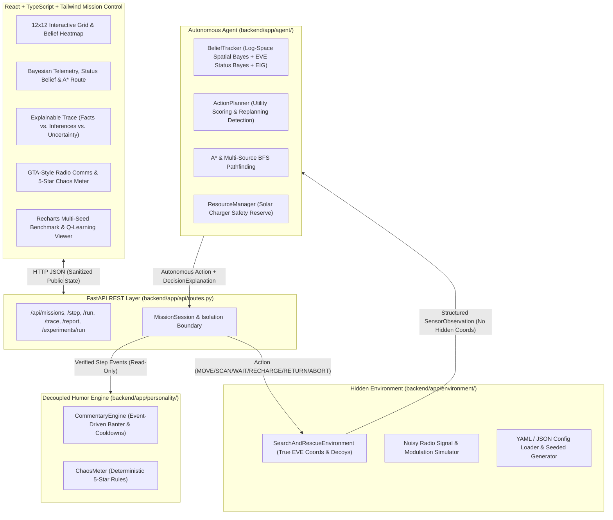

# WALL-E: NO SIGNAL, NO CHILL

**WALL-E: No Signal, No Chill — An autonomous search-and-rescue simulator with probabilistic reasoning, resource-aware planning, and a robot who has absolutely had enough.**

> *"One missing robot. One unreliable sensor. One extremely underqualified hero."*
>
> **The jokes are optional. The algorithms are not.**

---

## 1. Overview 

Imagine EVE has gone missing somewhere inside a $12 \times 12$ industrial sector filled with rubble walls, solar charging stations, and counterfeit decoy radio beacons. WALL-E has to find her—but **WALL-E is never allowed to peek at EVE's true coordinates**.

Instead, WALL-E has to think like a real autonomous robot:
1. **Start with an open mind (Uniform Prior):** At step 0, every non-obstacle cell on the map has the exact same chance of hiding EVE, and WALL-E maintains a probability estimate over EVE's operational status (`OPERATIONAL_SIGNAL`, `CRITICAL_LOW_POWER`, or `DORMANT_INTERFERENCE`).
2. **Use noisy radio scans (Bayesian Updating):** Whenever WALL-E triggers a radio scan, the environment returns a noisy signal reading between `0.0` and `1.0`. Using **Bayes' theorem**, WALL-E updates the probability of every cell on the map—boosting regions whose distance matches the signal strength and lowering regions that don't fit the evidence.
3. **Decide whether to Scan, Move, Recharge, Return, or Abort (Information Gain & A* Planning):** Scanning costs battery and time, so WALL-E calculates **Shannon Entropy** (how uncertain the map currently is) and **Expected Information Gain (EIG)** (how much a scan here is expected to reduce uncertainty). When a strong candidate region emerges, WALL-E plans the shortest obstacle-free **A\*** path toward it while continuously checking that it has enough battery left to reach a solar charging dock.
4. **Stay hilarious without breaking the math:** A completely separate personality subsystem watches the mission events (false alarms at decoys, low-battery panics, wall bumps, hypothesis shifts) and generates GTA-style satirical radio banter and a **5-Star Chaos Meter**. Turning humor off leaves the exact same mathematical decisions intact.

---

## 2. System Architecture

The Python FastAPI backend owns **100% of the simulation state, hidden coordinates, sensor physics, Bayesian inference, A* pathfinding, resource management, trace logging, and multi-seed benchmarking**. The React + TypeScript frontend is a pure mission-control visualization and telemetry client.



### Critical Hidden-State Isolation Guarantee
- `SearchAndRescueEnvironment` stores `_target_position`, `_decoy_positions`, and `_true_eve_status` privately.
- `FullMissionConfig.to_public()` strips `target_position`, `decoy_positions`, and `true_eve_status` before constructing `PublicMissionConfig`.
- `AutonomousAgent.__init__()` explicitly raises a `ValueError("SECURITY VIOLATION")` if passed any configuration object containing `target_position`.
- Ground-truth coordinates are **only** disclosed inside `PostMissionEvaluation` after the mission status transitions out of `ACTIVE`/`PAUSED`.

### 3D Mission View
The dashboard defaults to a 3D tactical view (toggle to the classic **2D Grid** at any time), built with `three.js` and React Three Fiber:
- **Procedural 3D WALL-E** (`frontend/src/components/WalleModel.tsx`) made from primitives, so there are no model files to download. It glides between cells, turns toward its heading, scans with flaring eyes, and droops with red eyes when the battery is low.
- **3D map** (`frontend/src/components/Scene3D.tsx`): the belief heatmap is a glowing floor whose tiles rise with posterior probability, plus obstacle blocks, solar docks, the A* route, and a pulse ring on every scan. Drag to orbit, scroll to zoom.
- **Presentation only:** the 3D scene reads the sanitized public mission state. It cannot influence planning, beliefs, or metrics, and EVE/decoys are drawn only after the mission ends.

---

## 3. Technical Algorithms & Mathematical Formulation

### 3.1 Sensor Signal & Likelihood Model (`backend/app/environment/sensors.py`)
Given sensor position $x \in \mathbb{Z}^2$ and true target position $t \in \mathbb{Z}^2$, the clean expected radio signal decays exponentially with Euclidean distance:

$$\mu(x, t) = \exp\!\left(-\lambda \lVert x - t \rVert_2\right)$$

where $\lambda$ is `signal_decay_rate` (default `0.14`). If decoy transponders $d \in D$ with strength factor $\alpha_d$ are present, the environment emits:

$$s = \text{clip}\!\left(\max\Big(\mu(x, t), \max_{d \in D} \alpha_d \mu(x, d)\Big) + \mathcal{N}(0, \sigma^2),\; 0,\; 1\right)$$

Because the agent does not know where decoys are, its observation likelihood $P(s \mid \text{EVE at } c, x)$ uses a heavy-tailed Gaussian-Uniform mixture model so a single decoy spike near $x$ never zeroes out distant true candidate cells:

$$\mathcal{L}(s \mid c) = (1 - \epsilon_{\text{tail}}) \cdot \frac{1}{\sigma\sqrt{2\pi}} \exp\!\left(-\frac{(s - \mu(x, c))^2}{2\sigma^2}\right) + \epsilon_{\text{tail}} \cdot 1$$

### 3.2 Log-Space Bayesian Belief Updates (`backend/app/agent/beliefs.py`)
1. **Prior Initialization:** Uniform prior $B_0(c) = \frac{1}{|C_{\text{valid}}|}$ over all non-obstacle cells, and $B_0(c) = 0$ on known obstacles.
2. **Physical Cell Inspection:** Visiting cell $x$ without finding EVE sets $B_t(x) = 0$ and renormalizes remaining cells. Physically verifying EVE at $x$ collapses $B_t(x) = 1.0$ ($H(B) = 0$).
3. **Radio Scan Update:** Computed in log-probability space with the log-sum-exp stabilization trick to prevent floating-point underflow across dozens of scans:

$$\ell_t(c) = \ln \max(B_{t-1}(c), 10^{-12}) + \ln \max(\mathcal{L}(s \mid c), 10^{-12})$$

$$B_t(c) = \frac{\exp(\ell_t(c) - \max_{c'} \ell_t(c'))}{\sum_{k \in C_{\text{valid}}} \exp(\ell_t(k) - \max_{c'} \ell_t(c'))}$$

4. **EVE Operational Status Belief:** Alongside spatial coordinates, `BeliefTracker` maintains a normalized posterior distribution over `OPERATIONAL_SIGNAL`, `CRITICAL_LOW_POWER`, and `DORMANT_INTERFERENCE` updated via Bayes' rule from signal modulation hints and carrier residuals.

### 3.3 Shannon Entropy & Expected Information Gain (`backend/app/agent/beliefs.py`)
Current spatial uncertainty is quantified via Shannon entropy (in nats):

$$H(B) = -\sum_{c:\, B(c) > 0} B(c) \ln B(c)$$

To estimate the usefulness of scanning at position $x$ in under $1\text{ ms}$, `expected_information_gain(x)` evaluates a 5-point predictive observation quadrature $s_k = \text{clip}(\bar{\mu}(x) + z_k \sigma_{\text{pred}}, 0, 1)$ weighted by marginal likelihood $P(s_k \mid x) = \sum_c B(c)\mathcal{L}(s_k \mid c)$:

$$\text{EIG}(x) = \max\!\left(0,\; H(B) - \sum_{k=1}^{5} w_k H(B_{t+1} \mid s_k, x)\right)$$

### 3.4 Utility-Driven Action Selection, A* Pathfinding & Battery Management (`backend/app/agent/planner.py`)
At every step, `ActionPlanner` evaluates:
1. **Solar Charger Reserve (`ResourceManager`):** Computes shortest A* path distance $d_{\text{charger}}(x)$ to the nearest charging station. If battery $E \le d_{\text{charger}}(x)\cdot c_{\text{move}} + c_{\text{scan}} + c_{\text{move}}$, the planner overrides search and routes via A* to the solar dock (or executes `RECHARGE` when docked).
2. **Information-Gain Scan Check:** Executes `SCAN` if the current cell is unscanned, safe return energy is preserved, and either $t = 0$ or uncertainty remains high ($\max_c B(c) < 0.28$ and $\text{EIG}(x) \ge 0.04$ after $\ge 4$ steps).
3. **Candidate Goal Scoring:** Every reachable unvisited candidate cell $c$ is scored by combining posterior probability, 4-neighbor cluster probability mass, and normalized BFS/A* travel distance:

$$U(c) = w_{\text{prob}} B(c) + w_{\text{cluster}} \sum_{n \in \mathcal{N}_4(c)} B(n) - w_{\text{dist}} \frac{d_{A^*}(x, c)}{W + H}$$

with documented weights $w_{\text{prob}} = 28.0$, $w_{\text{cluster}} = 8.0$, $w_{\text{dist}} = 0.65$.
4. **Unreachable Target & Safe Abort (`ABORT` / `RETURN`):** If all remaining candidate cells are blocked by obstacles—or if $>88\%$ of posterior probability mass lies inside a sealed off sector after triangulation—WALL-E executes `ABORT` immediately rather than wandering in an infinite loop.

---

## 4. Humour Engine & 5-Star Chaos Meter Separation

- **`backend/app/personality/commentary.py` (`CommentaryEngine`):** Consumes verified step events (`MISSION_START`, `SIGNAL_DETECTED`, `FALSE_ALARM`, `WEAK_SCAN`, `OBSTACLE`, `LOW_BATTERY`, `CHARGING`, `PLAN_CHANGED`, `INEFFICIENT_ROUTE`, `MISSION_SUCCESS`, `MISSION_FAILURE`, `MISSION_TIMEOUT`, `MISSION_UNREACHABLE`), applies a 3-step per-event cooldown, and rotates dialogue variations with dispatcher replies.
- **`backend/app/personality/chaos_meter.py` (`ChaosMeter`):** Deterministically accumulates stress points (`FALSE_ALARM: +25`, `LOW_BATTERY: +20`, `BLOCKED_ACTION: +20`, `REPEATED_ACTION: +15`, `PLAN_CHANGED: +10`, `WEAK_SCAN: +8`, `MISSION_FAILURE: +50`, `RECHARGE_RELIEF: -12`) and maps score brackets (`0-19`, `20-39`, `40-64`, `65-89`, `90+`) to 1–5 Stars with an explicit audit log.

---

## 5. REST API Reference

| Method | Endpoint | Description |
| :--- | :--- | :--- |
| `GET` | `/api/health` | Health check and preset count. |
| `GET` | `/api/presets` | List sanitized public mission presets. |
| `POST` | `/api/missions` | Create a mission from `preset_id`, `config_file` (`config.yaml` / JSON), or `custom_config`. |
| `GET` | `/api/missions/{mission_id}` | Get current sanitized `PublicMissionState`. |
| `POST` | `/api/missions/{mission_id}/step` | Execute one autonomous agent step and return updated state. |
| `POST` | `/api/missions/{mission_id}/run` | Run autonomous loop until termination or `max_steps`. |
| `POST` | `/api/missions/{mission_id}/pause` | Pause an active mission. |
| `POST` | `/api/missions/{mission_id}/reset` | Reset mission to step 0 with identical seed. |
| `GET` | `/api/missions/{mission_id}/trace` | Get structured JSON step trace (`observed_facts`, `inferred_conclusions`, `uncertainty_metrics`). |
| `GET` | `/api/missions/{mission_id}/report` | Get automatic final `PostMissionEvaluation` report after mission termination. |
| `POST` | `/api/experiments/run` | Execute reproducible multi-seed benchmark across noise levels. |

Interactive Swagger documentation is available automatically at `http://127.0.0.1:8000/docs`.

---

## 6. Actual Benchmark Methodology & Measured Results

Using `backend/scripts/verify_all_scenarios.py` and `POST /api/experiments/run`, we evaluated three policies across **30 reproducible random seeds per noise level** (`base_seed=100`, 90 seeded trials per policy, 270 total simulations) at three sensor noise standard deviations ($\sigma \in \{0.06, 0.10, 0.16\}$):

1. **Bayesian + EIG Autonomous Agent:** Log-space Bayesian tracker, Expected Information Gain scan trigger, A* routing, and solar charger reserve management.
2. **Tabular Q-Learning Policy:** Trained for 80 episodes (`base_seed=5100`, $\alpha=0.25, \gamma=0.94$) over a 36-state discrete abstraction (`entropy_bin`, `battery_bin`, `scan_recency_bin`, `at_charger`) selecting macro-actions (`SCAN_HERE`, `MOVE_BAYES_MAP`, `MOVE_FRONTIER`, `ROUTE_OR_RECHARGE`).
3. **Uninformed Exploration Baseline:** Obstacle-avoiding random frontier explorer with periodic scans every 6 steps and charger return at $\le 26\%$ battery, without Bayesian belief aggregation.

### Measured Benchmark Table (30 Seeds per Noise Level)

| Policy | Sensor Noise ($\sigma$) | Trials | Mission Success Rate | Avg Actions (Success) | Avg Actions (Overall) | Avg Energy Consumed | Avg Scans | Stranded / Failed Rate |
| :--- | :---: | :---: | :---: | :---: | :---: | :---: | :---: | :---: |
| **Bayesian + EIG Autonomous Agent** | `0.06` | 30 | **100.0%** | **28.7** | **28.7** | **62.1** | **5.4** | **0.0%** |
| **Tabular Q-Learning Policy** | `0.06` | 30 | **100.0%** | 35.5 | 35.5 | 77.2 | 8.0 | 0.0% |
| **Uninformed Exploration Baseline** | `0.06` | 30 | 36.7% | 61.9 | 82.9 | 171.2 | 11.9 | 63.3% |
| **Bayesian + EIG Autonomous Agent** | `0.10` | 30 | **100.0%** | **34.3** | **34.3** | **74.6** | **6.8** | **0.0%** |
| **Tabular Q-Learning Policy** | `0.10` | 30 | **100.0%** | 39.1 | 39.1 | 84.0 | 7.8 | 0.0% |
| **Uninformed Exploration Baseline** | `0.10` | 30 | 36.7% | 61.9 | 82.9 | 171.2 | 11.9 | 63.3% |
| **Bayesian + EIG Autonomous Agent** | `0.16` | 30 | **96.7%** | **42.7** | **44.4** | **95.3** | **8.5** | **3.3%** |
| **Tabular Q-Learning Policy** | `0.16` | 30 | 90.0% | 41.5 | 46.9 | 100.2 | 9.2 | 10.0% |
| **Uninformed Exploration Baseline** | `0.16` | 30 | 36.7% | 61.9 | 82.9 | 171.2 | 11.9 | 63.3% |

### Measured Scenario Verification Runs

| Scenario Preset | Final Status | Actions Taken | Scans | Recharges | Energy Used | Final MAP Estimate | Inferred EVE Status |
| :--- | :---: | :---: | :---: | :---: | :---: | :---: | :---: |
| `normal` (Sector 7G) | `SUCCESS` | 34 | 7 | 0 | 75 | `(9, 10)` (`100%`) | `CRITICAL_LOW_POWER` |
| `misleading_decoy` (2 Decoys) | `SUCCESS` | 68 | 13 | 2 | 145 | `(10, 9)` (`100%`) | `DORMANT_INTERFERENCE` |
| `low_battery` (Cap=56) | `SUCCESS` | 32 | 6 | 1 | 68 | `(8, 9)` (`100%`) | `CRITICAL_LOW_POWER` |
| `unreachable` (Sealed Vault) | `FAILED_UNREACHABLE` | 31 | 6 | 0 | 66 | `(11, 10)` (`17%`) | `CRITICAL_LOW_POWER` |
| `high_noise` ($\sigma=0.14$) | `SUCCESS` | 39 | 8 | 1 | 84 | `(8, 10)` (`100%`) | `DORMANT_INTERFERENCE` |
| `failed_demo` (10-Step Limit) | `FAILED_TIMEOUT` | 10 | 2 | 0 | 22 | `(11, 0)` (`1%`) | `CRITICAL_LOW_POWER` |

---

## 7. Windows PowerShell Setup & Startup Instructions

### 7.1 Backend Setup & Startup (Port 8000)
Open Windows PowerShell in the project root directory:

```powershell
py -m venv .venv
.\.venv\Scripts\Activate.ps1
python -m pip install -r backend/requirements.txt
uvicorn app.main:app --app-dir backend --reload
```

### 7.2 Frontend Setup & Startup (Port 5173)
Open a second Windows PowerShell terminal in the project root directory:

```powershell
cd frontend
npm install
npm run dev
```

Then open **`http://localhost:5173`** in your browser.

### 7.3 Running Automated Tests & Verification Scripts
```powershell
$env:PYTHONPATH="backend"
.\.venv\Scripts\pytest.exe backend/tests -v
.\.venv\Scripts\python.exe backend/scripts/verify_all_scenarios.py
```

---

## 8. Known Limitations & Future Improvements

1. **In-Memory Session Store:** Active missions are stored in `MissionStore` (bounded to 50 concurrent sessions in RAM). Restarting the FastAPI process clears in-flight sessions.
2. **Bounded 5-Point Quadrature EIG:** Exact continuous integration for Expected Information Gain over all $144$ cells is approximated via a 5-point predictive signal quantile quadrature to keep step latency under $2\text{ ms}$.
3. **Single-Step Myopic Horizon:** The planner scores global A* paths and 4-neighbor probability clusters but does not solve a full multi-step POMDP tree search.
4. **Next Highest-Value Improvement:** Extending the planner to a 2-step rollout lookahead that jointly optimizes intermediate scan waypoints along the A* path toward a solar charger.
